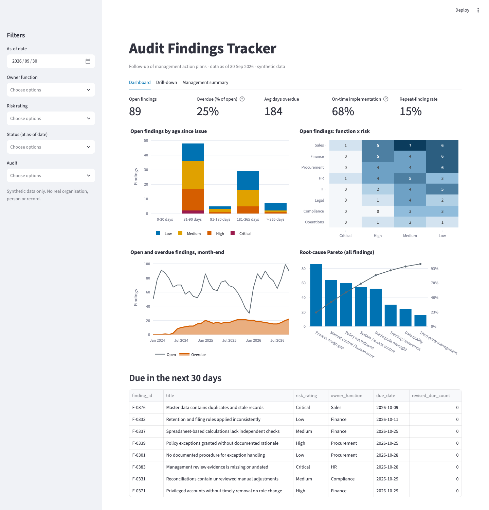
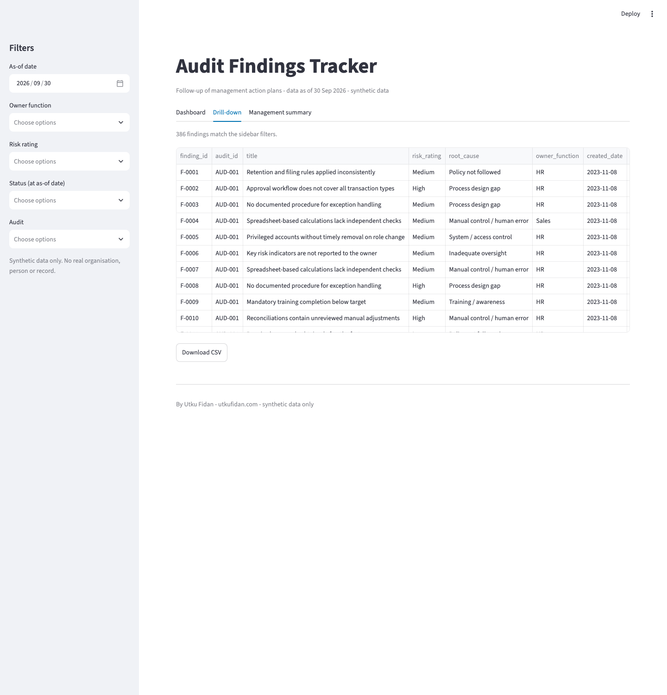
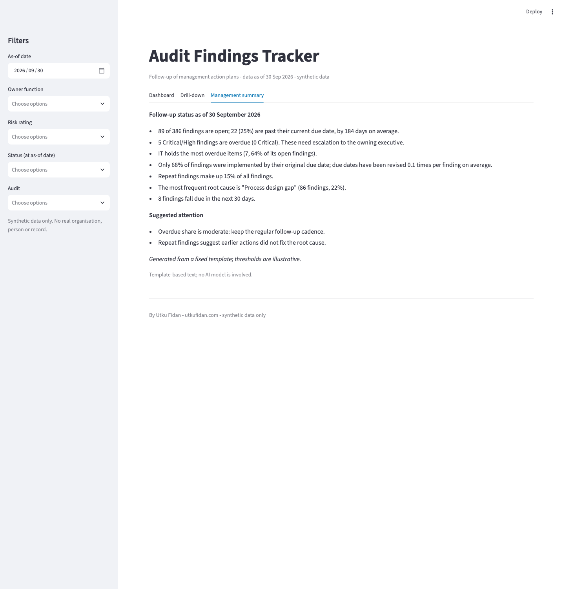

# Audit Findings Tracker

A Streamlit dashboard for following up internal audit findings and management action plans: what is open, what is late, which functions keep slipping, and which root causes keep coming back.

All data is synthetic. A seeded script generates every record; no real organisation, person, audit or finding is behind it. I have not used this in production.



## Why I built this

Issuing a finding is half the job. The IIA standards expect internal audit to confirm that agreed actions are actually implemented, and every quarter the same questions come up: how many are open, how many are past due, how often are dates moved, and is the same issue being raised again. In my experience these answers often live in spreadsheets where "overdue" means different things to different people. I wanted one set of written-down metric definitions, tested in code, that anyone can re-run on the same data and get the same numbers.

## What it shows

- KPI tiles: open findings, overdue share, average days overdue, implementation within the original due date, repeat-finding rate
- Ageing buckets stacked by risk rating, a function by risk heatmap, a month-end overdue trend and a root-cause Pareto
- A "due in the next 30 days" table
- A drill-down table with filters (function, risk, status, audit) and CSV export
- A management summary tab: a fixed text template filled from the metrics, no language model, same input gives the same text
- A colour-blind-safe palette (Okabe-Ito based); each risk rating keeps its colour in every chart
- Metrics in a tested module (`src/findings_tracker/metrics.py`), separate from the UI

At the committed snapshot (30 Sep 2026) the data holds 386 findings from 36 audits. 89 findings are open and 22 of them are overdue (25%), by 184 days on average. 68% of due findings were implemented by the original date, and 15% of findings are repeats. IT has the most overdue items (7 of 11 open).

| Drill-down | Management summary |
|---|---|
|  |  |

## Quickstart

```bash
python3 -m venv .venv && source .venv/bin/activate
pip install -e ".[dev]"

streamlit run app.py          # uses the committed CSVs in data/
findings-tracker generate --seed 7 --out data   # optional; reproduces the committed CSVs exactly

ruff check . && ruff format --check . && pytest
```

Set `FINDINGS_DATA_DIR` to point the app at another folder with the same CSV layout. Requires Python 3.10+.

## Data model

CSV files in `data/` (plus `meta.json` holding the snapshot date used as the default "as of").

audits.csv

| Column | Meaning |
|---|---|
| audit_id | e.g. `AUD-001` |
| entity | audit universe entity (e.g. Payroll, Change Management) |
| audit_type | Financial, Operational, IT, Compliance, Follow-up |
| period_start, period_end | period covered by the audit |
| report_date | date findings were issued |
| rating | Satisfactory, Needs improvement, Unsatisfactory |

findings.csv

| Column | Meaning |
|---|---|
| finding_id | e.g. `F-0001` |
| audit_id | link to audits |
| title | short description |
| risk_rating | Critical, High, Medium, Low |
| root_cause | root-cause category |
| owner_function | function responsible for the action |
| created_date | date issued |
| original_due_date | due date agreed when issued |
| due_date | current due date after any revisions |
| resolved_date | date implemented or risk accepted; empty while open |
| status | Open, In progress, Implemented, Validated, Overdue, Risk accepted (as at snapshot) |
| revised_due_count | number of due-date revisions |
| repeat_flag | `True` if the finding repeats an earlier one |

updates.csv (action-plan update log): `update_id, finding_id, update_date, update_type` (Finding raised, Status change, Due date revised), `old_due_date, new_due_date, new_status, comment`.

`original_due_date` and `resolved_date` are additions to the minimal field list: they are needed to measure on-time implementation and to reconstruct history.

## Metric definitions

Every metric takes an as-of date and derives status from dates, not from the stored status column.

- Open: created on or before the as-of date and not yet resolved (implemented, validated or risk-accepted) on that date.
- Overdue: open and the *current* (revised) due date is before the as-of date. A finding with a formally extended due date is not overdue. That is why I track the revision count separately: extensions can hide slippage.
- Overdue %: overdue / open.
- Average days overdue: mean of (as-of date - current due date) over overdue findings.
- Implementation within original due date: findings resolved on or before the *original* due date, divided by findings that are implemented/validated plus unresolved findings whose original date has passed. Risk-accepted findings and findings not yet due are excluded.
- Repeat-finding rate: share of findings with `repeat_flag = True`.
- Ageing: days since issue for open findings, in buckets 0-30, 31-90, 91-180, 181-365 and over 365 days.
- Overdue trend: at each month end, open and overdue counts using the due date in force at that time, rebuilt from the updates log, so later extensions do not rewrite history.
- Root-cause Pareto: findings per root cause, descending, with cumulative share.

## Synthetic data

`findings-tracker generate --seed 7` is deterministic and produces 36 audits, 386 findings and 1,251 updates over three years. I modelled Procurement and IT as chronically late and frequent extenders, and Compliance and Finance as reliable. Some actions stall for well over a year, and re-audited entities produce repeat findings. These patterns are invented for illustration. The summary thresholds (25% overdue, 60% on-time) are illustrative too, not a standard.

## Project layout

```
app.py                      Streamlit UI
src/findings_tracker/       metrics.py, summary.py, generate.py, data.py, palette.py, cli.py
tests/                      pytest suite for metrics, generator and summary
data/                       generated CSVs (about 200 KB)
docs/                       screenshots
```

## Limitations

- The data is synthetic, so the patterns are only as realistic as my assumptions.
- The dashboard is read-only. It does not write back to a findings system or handle access control.
- The overdue trend relies on the updates log being complete. A missing "Due date revised" entry would overstate lateness.
- The management summary thresholds are illustrative and would need agreeing with the audit committee before real use.

## License

MIT, see [LICENSE](LICENSE).

---

By Utku Fidan · [utkufidan.com](https://utkufidan.com)
